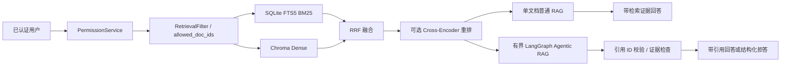

# Enterprise Support Agent（企业技术支持与故障诊断平台）

企业技术支持与故障诊断平台。工程师可以同时查阅有权访问的版本说明、SOP 和历史工单，
按带页码或分块引用的答案回溯证据。Dense 和 BM25 在召回前应用同一权限范围，RRF 合并候选，
LangGraph 控制检索重试并支持证据不足时拒答。

[故障诊断演示](docs/support-demo.md)涵盖跨文档诊断、同题切换权限和证据不足时拒答。
[请求链路图](docs/architecture.md)展示权限条件如何进入两路检索。

**本地开发版评测（2026-11-21）**使用 174 份英文合成资料和 357 道题。在 281 道可回答题上，
Hybrid RRF 的 Recall@5 为 **89.0%**，较 BM25 提升 **9.25 个百分点**。使用本地抽取模型在同一题集上对照时，
正确拒答率由 **20.3% 升至 100%**，误拒率由 **11.4% 降至 5.7%**。新增 48 道验证题上，正确拒答率为 100%，误拒率为 0%。

扩充题集和本轮拒答改进来自尚未同步到 `main` 的本地开发版。
[当前公开版本的评测与复现](docs/evaluation.md)

## 请求链路



## 已实现能力

- FastAPI Users 注册、JWT 登录/刷新、HttpOnly cookie
- 文档类型、产品、版本、部门、知识空间、可见性 metadata
- Chroma Dense 检索 + SQLite FTS5 BM25 + Reciprocal Rank Fusion
- 两路检索前使用相同的权限与 metadata filter
- 可选本地 sentence-transformers Cross-Encoder（`local-ml` Extra）或 Cohere reranker；失败可配置 fail-open，日志不写正文
- 普通工具调用 RAG 和 LangGraph Agentic RAG 双路径
- Agentic RAG 支持单文档或权限范围内多文档检索，最多 1–3 次（默认 2），引用 ID 完整性校验和证据不足拒答
- SSE 阶段事件：分类、改写、检索、生成、引用校验失败重试、完成或拒答
- 持久化摄取任务、SHA-256 幂等、后台开发模式和 Redis/ARQ worker 模式
- private / department / workspace 权限，admin / workspace_admin / member 角色
- PostgreSQL + pgvector 语义缓存；提供包含权限范围与 pipeline 版本的规范缓存指纹
- 原有检索评测，以及覆盖实际问答路由、引用与权限的本地 JSON 报告
- 无密钥本地 hash embedding 与严格抽取式 LLM 降级；hash embedding 仅用于链路验证，不宣称语义检索质量

## 本地启动

Python 3.12+、`uv` 和 Docker Compose：

```bash
cp .env.example .env
# 修改 POSTGRES_PASSWORD 和四个 JWT secret；本地 provider 无需第三方 key
docker compose up -d db redis
uv sync --dev
uv run alembic upgrade head
uv run uvicorn main:app --host 0.0.0.0 --port 8000
```

仓库内的 Compose 配置用于本地开发，数据库、Redis、API 和可选 pgAdmin 默认只绑定 `127.0.0.1`。需要 pgAdmin 时运行 `docker compose --profile tools up -d pgadmin`。

默认安装不包含 Torch、CUDA、sentence-transformers。只有需要本地 Hugging Face Embedding 或 Cross-Encoder 时才安装：

```bash
uv sync --dev --extra local-ml
```

生产式异步 worker：把 `.env` 中 `INGESTION_MODE=arq`，另开终端：

```bash
uv run arq src.modules.ingestion.worker.WorkerSettings
```

### 使用通义千问

设置 `LLM_PROVIDER=qwen`，并在当前项目 `.env` 或进程环境中提供 `DASHSCOPE_API_KEY`、`DASHSCOPE_BASE_URL`、`DASHSCOPE_MODEL_NAME`：

```bash
./scripts/run_with_qwen.sh
curl http://127.0.0.1:8000/llm/health
```

如需读取其他位置的环境文件，可设置 `DASHSCOPE_ENV_FILE=/absolute/path/to/file`。生产部署应由 Secret Manager 或容器环境直接注入密钥。Embedding Provider 与 LLM Provider 独立；切换到千问生成时可继续使用现有本地 Embedding，无需重建索引。

也可运行完整的本地开发 Compose：`docker compose up --build`。API 文档位于 `http://localhost:8000/docs`。

## 生产安全

- 设置 `ENVIRONMENT=production`；此模式会拒绝短于 32 字符的占位 JWT 密钥，并强制启用 Secure Cookie。
- 不要公开暴露 PostgreSQL、Redis、pgAdmin 或 Chroma。当前 Chroma 仅按进程内 `PersistentClient` 使用。
- 使用 Secret Manager 注入数据库密码、JWT 密钥和第三方 API Key，不要提交 `.env`、上传文档或本地索引。
- 开发 Compose 包含热重载和源码挂载，不是生产部署清单。更多说明见 [SECURITY.md](SECURITY.md)。

## 最小 API 流程

```bash
# 注册
curl -X POST http://localhost:8000/auth/register -H 'Content-Type: application/json' \
  -d '{"email":"intern@example.com","password":"ChangeMe123!"}'

# department 只能由超级管理员分配，注册和普通资料更新传入该字段会返回 422
# PATCH /users/{user_id}/department  body: {"department":"payments"}

# 登录（保存 cookie，也返回 access_token）
curl -c cookies.txt -X POST http://localhost:8000/auth/jwt/login \
  -H 'Content-Type: application/x-www-form-urlencoded' \
  -d 'username=intern@example.com&password=ChangeMe123!'

# 异步摄取
curl -b cookies.txt -X POST http://localhost:8000/ingestion/text \
  -H 'Content-Type: application/json' \
  -d '{"doc_id":"ticket-1842","text":"E_CONN_TIMEOUT ...","source":"INC-1842","document_type":"ticket","product_name":"Nebula Gateway","product_version":"3.2"}'

# 查询任务：GET /ingestion/tasks/{task_id}
# 人工恢复失败任务：POST /ingestion/tasks/{task_id}/retry
# Hybrid 检索：POST /rag/retrieve
# 多文档 Agentic：省略 doc_id，按权限和 Metadata 同时检索 Release Notes/SOP/工单
curl -b cookies.txt -X POST http://localhost:8000/agent/ask/agentic \
  -H 'Content-Type: application/json' \
  -d '{"question":"结合版本记录、SOP 和历史工单诊断 3.2 超时", "product_name":"Nebula Gateway", "product_version":"3.2", "document_types":["release_note","sop","ticket"]}'
# SSE 使用同一请求结构：POST /agent/ask/stream
```

旧的 `/rag/ingest/text` 和 `/rag/ingest/pdf` 保留为同步兼容端点；新调用应使用 `/ingestion/*`。

## 验证

```bash
uv run pytest -q
uv run ruff check src main.py scripts eval
uv run mypy src main.py
uv run python eval/run_local_evaluation.py
docker compose --env-file .env.example config
bash scripts/audit_dependencies.sh
```

逐题报告生成到 `eval/reports/evaluation-report.json`。本地语义模型与重排对照命令见[评测说明](docs/evaluation.md)。

详细资料：

- [架构说明](docs/architecture.md)
- [评测说明](docs/evaluation.md)
- [故障排查](docs/troubleshooting.md)
- [贡献指南](CONTRIBUTING.md)
- [安全策略](SECURITY.md)

## 来源与许可

项目采用 [MIT 许可](LICENSE)。上游来源与第三方许可说明见 [NOTICE](NOTICE)。
